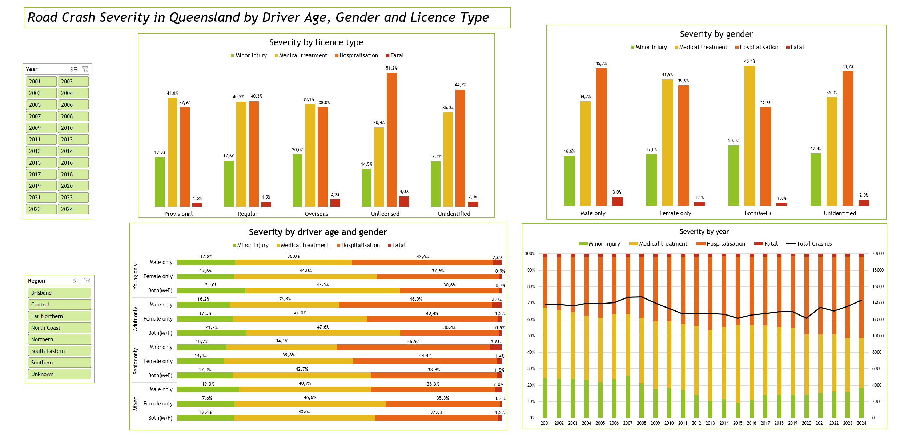

# Overview

This project was created to answer questions related to crash severity in Queensland.

## Questions to Answer

How are driver age, gender and licence type associated with crash severity?

## Tools Used

- Microsoft Excel

# Key Findings
- Crashes involving an unlicensed driver have the highest fatal share: 4.0%, about twice the 1.9% of Regular.
- Crashes with only male drivers recorded have a fatal share of 3.0% against 1.1% with only female drivers recorded; the gap appears in every age group.
- The fatal share stays near 2% from 2001 to 2024, while the hospitalisation share rises from 30.5% to 49.1%.

# Analysis

Shares are the percentage of crashes with casualties in each group, split by the most severe outcome of the crash. Figures cover all regions and years (2001–2024) unless stated otherwise.

### 1. Severity by Licence Type
**Crashes involving an unlicensed driver have the highest share of serious outcomes.**
* Unlicensed: 51.2% hospitalisation and 4.0% fatal, against 40.3% and 1.9% for Regular. The fatal share is about twice as high.
* Overseas: 2.9% fatal. Provisional: 1.5% fatal, the lowest of the groups.
* A crash belongs to a licence group if at least one identified driver in it has that licence type. Regular means none of the three flags is set, so it can include unknown licence types.

### 2. Severity by Gender
**Crashes with only male drivers recorded have a higher share of fatal and hospitalisation outcomes than crashes with only female drivers recorded.**
* Male only: 3.0% fatal and 45.7% hospitalisation.
* Female only: 1.1% fatal and 39.9% hospitalisation, with a higher share of medical treatment (41.9% against 34.7%).
* Both involves at least two drivers and shows 1.0% fatal. It is not directly comparable with the other two groups, which also include single-vehicle crashes.

### 3. Severity by Driver Age and Gender
**The male–female gap in the fatal share appears in every age group.**
* The highest fatal share is Senior Male only (3.8%), followed by Adult Male only (3.0%) and Young Male only (2.6%).
* In the three largest age groups the male fatal share is 2.5–2.9 times the female one (Young 2.6% vs 0.9%, Adult 3.0% vs 1.2%, Senior 3.8% vs 1.4%).
* Mixed Female only (0.6% fatal) rests on only 9 fatal crashes, too few to interpret.
* Severity is the worst outcome of the crash, not the injury of the driver in the group: the injured person may be a passenger or another road user.

### 4. Trends, 2001–2024
**The fatal share is stable, but the mix of non-fatal outcomes changes.**
* The fatal share stays between roughly 1.5% and 2.3% in every year.
* The hospitalisation share rises from 30.5% (2001) to 49.1% (2024). The minor injury share falls from 24.6% to 9.1% (2015) and recovers to 18.3% by 2024. The data cannot show whether this reflects real changes or changes in how injuries are classified and recorded.
* Crashes with casualties peaked at 14,770 in 2008, stayed at about 12,200–13,000 a year in 2011–2019 and hit the series minimum in 2020 (12,147), which coincides with the COVID-19 pandemic. The 2024 total is 14,358.

# Data

Shares describe the severity mix of crashes, not the risk of a driver type (there is no data on how many drivers or kilometres each group has), and they show associations, not causes.

## Source and Definitions
Source: Queensland Department of Transport and Main Roads (via Kaggle). Each row is a crash type with a count of crashes.
- Shares show the percentage of crashes in each group by their most severe outcome. Counts are sums of `count_crashes`.
- Young = at least one 16–24 driver and no 60+ driver; Senior = at least one 60+ driver and no 16–24 driver; Mixed = both; Adult = neither flag (25–59 or age not recorded). Other age groups may also be present, since there is no flag for them.
- Male only / Female only = at least one male (female) driver and no known driver of the other gender. Both = at least two drivers.
- Regular = none of the provisional, overseas or unlicensed flags.
- Severity is the worst outcome of the crash, not of the flagged driver.
- Unidentified = no driver recorded.

## Excluded
- Property damage only (recorded only until 2010).
- Crashes with no identified driver on the age and gender chart.
- Combinations of licence types (about 0.45%) on the licence chart.